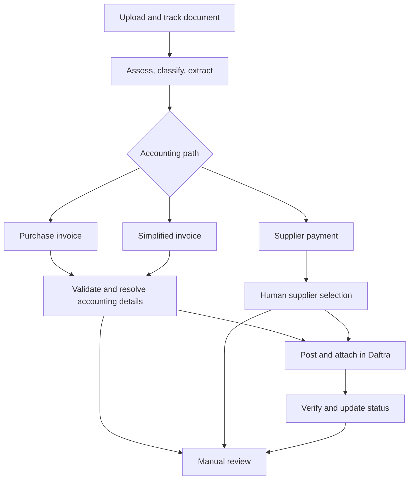

# AI-Assisted Purchase Invoice Automation

An accounting automation project that takes a document from upload through review, posting, verification, and a traceable final status. Built with **n8n**, AI document extraction, **Daftra**, **Google Drive**, and **Google Sheets**.

The main path processes purchase invoices. Additional paths handle simplified tax invoices and supplier payment receipts. The production workflow and business data remain private.

## The problem

Purchase documents arrive in different formats and levels of quality. Names can be inconsistent, accounting fields can be missing, and a payment receipt may not establish which supplier should be paid. Recording a document correctly requires several decisions across document handling, accounting, and the ERP. A successful API response alone does not always prove that a record was saved.

## What I built

I designed an end-to-end workflow with an upload and status interface. It accepts the original document, stores it, identifies its type, extracts structured data, validates the result, routes the case to the right accounting path, and records an auditable outcome.

| Capability | What the workflow does |
| --- | --- |
| Document intake | Accepts an upload, preserves the original file, and provides a way to check processing status. |
| AI-assisted understanding | Assesses document quality, classifies the document, and extracts structured fields. |
| Purchase invoice controls | Checks buyer identity, required data, duplicate records, and the supplier match before posting. |
| Accounting decisions | Selects an expense account and routes simplified invoices through a separate journal-entry path. |
| Supplier payments | Reads receipts and pauses for explicit supplier selection when the document does not establish one. |
| ERP posting | Creates the appropriate Daftra record and attaches the source document where applicable. |
| Verification and audit | Reads back saved records when needed, records the final result, and surfaces uncertain cases for review. |

## How it works

The diagram shows the product-level flow. It intentionally leaves out production rules, prompts, API payloads, credentials, and client-specific configuration.

## Decisions that mattered

**AI proposes; validation decides.** Extraction and classification make the documents usable, but accounting checks determine whether a record is ready to post. Missing or contradictory information reaches a review state with a reason.

**A payment receipt may not identify its supplier.** The payment path asks a person to select the supplier and uses an explicit payment account. The operator still has to compare the chosen supplier with the beneficiary on the receipt.

**A save response is not the end of the transaction.** When Daftra redirects after saving, the workflow looks for the resulting payment and checks its saved details before reporting success. An uncertain save is left for reconciliation before any retry.

**Every document needs an outcome.** The upload interface exposes processing status, and the activity log captures success or the stage and reason that require attention.

## Illustrative outcomes

| Scenario | Workflow outcome |
| --- | --- |
| Valid purchase invoice with a resolved supplier and account | Post, attach the document, and record the result. |
| Invoice already present in the ERP | Stop the posting path and log the duplicate decision. |
| Simplified invoice requiring accounting entry | Route through the journal-entry path and check its attachment. |
| Receipt with an unclear supplier | Wait for a human selection before attempting a supplier payment. |
| Financial save whose result cannot be verified | Mark for manual reconciliation rather than blindly posting again. |

These are descriptions of paths in the workflow, not published production transactions or performance metrics.

## My contribution

Workflow design, document and accounting routing, validation and review states, ERP integration, upload/status experience, payment confirmation, and activity-log visibility.

## Stack

`n8n` · `AI document extraction` · `Daftra` · `Google Drive` · `Google Sheets`

## Confidentiality

The n8n export, custom scripts, prompts, ERP endpoints, credentials, cookies, customer and supplier data, and original documents are excluded from this public case study. See [Architecture](docs/architecture.md) for a higher-level description and [Security](SECURITY.md) for disclosure guidance.
