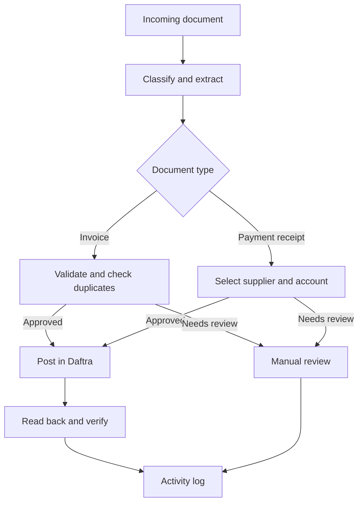

# Invoice & Supplier Payment Automation

An n8n workflow for reviewing supplier invoices and payment receipts before posting them to Daftra. Built for an Arabic and English document environment, with an activity trail in Google Sheets.

> Portfolio case study. The production workflow, prompts, API calls, credentials, client records, and source documents are intentionally private.

## What it does

- Classifies incoming documents and extracts invoice or receipt fields.
- Checks buyer identity, required fields, totals, and existing invoices before invoice posting.
- Routes exceptions to manual review instead of guessing accounting data.
- Requires a person to select the supplier and payment account for a supplier payment.
- Uploads the receipt attachment and creates the payment in Daftra.
- Confirms the saved payment from Daftra and records the result in an activity log.

## Process

## Key decisions

| Situation | Behavior |
| --- | --- |
| Missing or ambiguous supplier on a receipt | User selects the supplier before posting. |
| Missing payment account | Payment waits for a selected Daftra treasury account. |
| Invoice validation fails | Sent for manual review. |
| Daftra save response redirects to the supplier page | The workflow reads the payment list and payment detail before confirming success. |
| Save was sent but the result cannot be proved | Marked for manual review; do not automatically retry a financial POST. |

## Example outcome

In an internal test, a supplier payment was saved with an attachment. Daftra returned a redirect rather than a payment ID. A read-back check found the new payment, checked its amount, date, account, attachment, and execution marker, then updated the activity log. Identifiers and business data are omitted here.

## Stack

n8n · document extraction with an LLM · Google Drive · Google Sheets · Daftra

## Scope and limitations

The workflow relies on human selection when the receipt does not establish the supplier or bank account. A successful HTTP response alone is not proof that a financial record was created. The private production configuration and its integration tests are not part of this public case study.

For the design and data-handling boundaries, see [Architecture](docs/architecture.md) and [Security](SECURITY.md).
