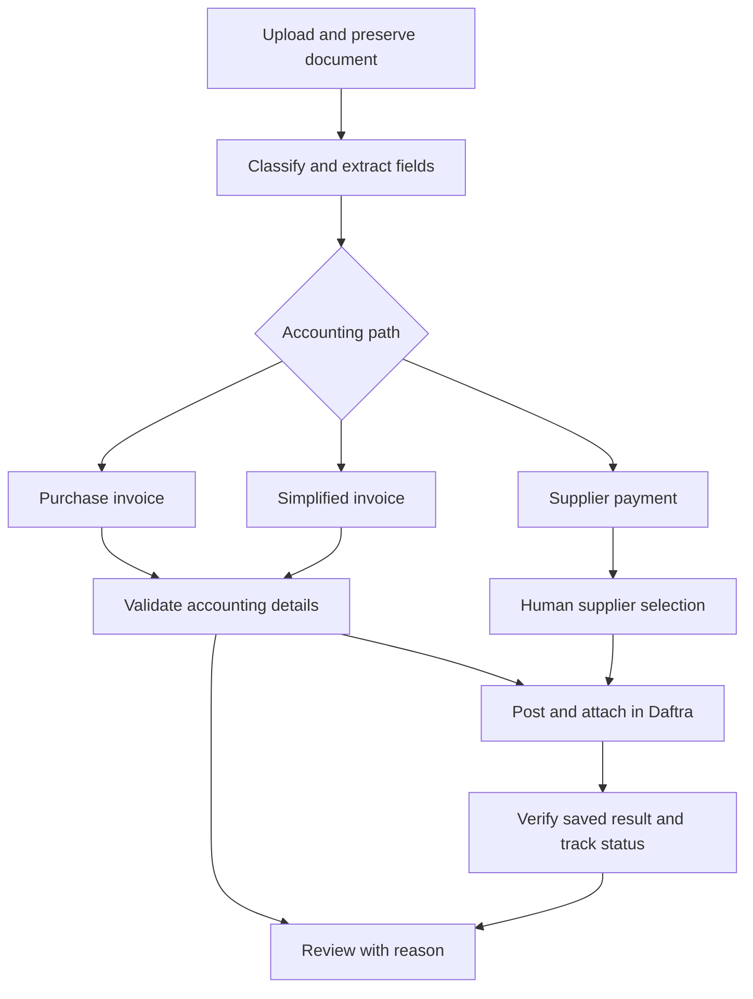

# Purchase Invoice Automation

## [▶ EXPLORE THE LIVE WORKFLOW](https://mostafaelramady05.github.io/AI-Assisted-Purchase-Invoice-Automation/)

**Zoom into 132 nodes · Search any node · Jump between workflow sections**

[Open the interactive workflow map →](https://mostafaelramady05.github.io/AI-Assisted-Purchase-Invoice-Automation/)

**A working accounting process built with n8n and Daftra.**

I built a system that accepts documents, extracts their data, checks accounting details, posts the appropriate record to the ERP, and tracks the result. It handles **purchase invoices, simplified tax invoices, and supplier payment receipts**.

My role: workflow design, accounting routing, validation, ERP integration, upload/status interface, and posting verification. I use automation to improve accounting and data work.

[Architecture & decisions](docs/architecture.md) · [Document journeys](sample-case.md) · [Explore live workflow](https://mostafaelramady05.github.io/AI-Assisted-Purchase-Invoice-Automation/)

## At a glance

| Business need | What I built |
| --- | --- |
| Documents arrive in different formats | Classification and structured extraction before accounting routing. |
| Extracted data needs accounting checks | Buyer, required-field, duplicate, and supplier checks before posting. |
| A receipt may not establish the supplier | Human supplier selection before the payment path continues. |
| A save response may be inconclusive | Saved-record verification and a reconciliation outcome when uncertain. |
| The operator needs to know what happened | Upload/status interface and activity-log visibility. |

## The workflow

This is a simplified architecture diagram, not an export of the production n8n canvas.

## Skills demonstrated through decisions

| Skill | Concrete decision in this project | What a reviewer can inspect |
| --- | --- | --- |
| Process analysis | Separate invoice, simplified-invoice, and payment paths instead of treating every document as the same transaction. | [Routing architecture](docs/architecture.md#accounting-routing) |
| Accounting judgment | Check buyer identity, supplier matching, required data, and duplicates before allowing invoice creation. | [Ready-to-record and review journeys](sample-case.md) |
| Structured data handling | Extract document fields into a structure that can be checked before ERP posting. | [Validation boundary](docs/architecture.md#validation-boundary) |
| n8n orchestration | Connect intake, classification, decisions, posting, and status updates into an end-to-end process. | [Explore the live workflow](https://mostafaelramady05.github.io/AI-Assisted-Purchase-Invoice-Automation/). |
| ERP integration | Record the appropriate Daftra transaction and attach its source document where applicable. | [Posting and verification](docs/architecture.md#posting-and-verification) |
| Exception handling | Pause for unclear supplier identity and leave uncertain saves for reconciliation. | [Supplier payment journey](sample-case.md#supplier-payment-unclear-beneficiary) |
| Operator experience | Expose document status and the stage/reason requiring attention. | [Operator feedback](docs/architecture.md#operator-feedback) |

## Three decisions worth inspecting

**Extraction is a proposal, not posting approval.** A readable document can still have the wrong buyer, missing accounting data, or an unresolved supplier. Accounting checks determine whether it proceeds.

**Supplier selection needs evidence.** When a payment receipt does not establish the supplier, the workflow asks for a selection. The operator must still compare the selected supplier with the beneficiary on the receipt.

**A save response is not confirmation.** When a Daftra save redirects, the workflow checks the resulting payment record before reporting success. An uncertain result goes to reconciliation before a retry, avoiding an unverified repeat financial posting.

## What is available to review

- **Architecture and decision rationale:** documented here and in the linked architecture page.
- **Illustrative cases:** fictional document journeys explaining successful, review, and uncertain outcomes.
- **Interactive workflow:** [open the live explorer](https://mostafaelramady05.github.io/AI-Assisted-Purchase-Invoice-Automation/) to zoom, search nodes, and jump between sections.
- **Evidence boundary:** the graph demonstrates actual node organization and routing. UI screenshots, observed execution examples, node parameters, and implementation code are not published here; the map does not prove execution outcomes.

## Stack

**n8n · AI document extraction · Daftra · Google Drive · Google Sheets**

## Scope of this repository

This is a public case study of an operational workflow, not a runnable n8n template. The production export, credentials, client documents, and business data remain private. Any future screenshots should show a reviewed presentation copy of the workflow.
